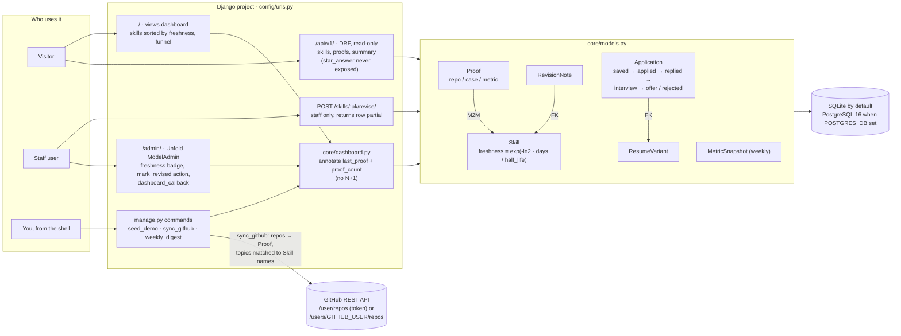

# Proof Ledger

A Django admin dashboard that tracks your skills, the proof behind each one, and your job-search
funnel. Skills lose freshness over time (a configurable half-life), so the dashboard always shows
what to revise next.

## Architecture



## Run it

```bash
python -m venv .venv && source .venv/bin/activate
pip install -r requirements-dev.txt
python manage.py migrate
python manage.py seed_demo
python manage.py createsuperuser
python manage.py runserver
```

- Public dashboard: [http://localhost:8000/](http://localhost:8000/)
- Admin: [http://localhost:8000/admin/](http://localhost:8000/admin/)
- API: [http://localhost:8000/api/v1/](http://localhost:8000/api/v1/) (read-only)

Or with Postgres: `docker compose up`.

## Commands

| Command                  | What it does                                                                                                                                                                                |
| ------------------------ | ------------------------------------------------------------------------------------------------------------------------------------------------------------------------------------------- |
| `seed_demo`              | Creates starter skills (with GitHub topic aliases) and resume variants. Edit levels to be honest.                                                                                           |
| `sync_github`            | Pulls every repo `GITHUB_USER` owns (paginated) as Proof rows and links skills by repo topic and primary language. Without `GITHUB_TOKEN` only public repos are visible; with it, private repos are included too. Forks and archived repos are skipped unless you pass `--include-forks` / `--include-archived`; `--prune` deletes proofs for repos GitHub no longer lists (renamed or deleted). It prints how many repos it found and why any were skipped. |
| `link_check`             | Requests every proof URL and flags dead links (`link_ok`), shown on the dashboard and admin.                                                                                                |
| `weekly_digest [--save]` | Prints a markdown plan: stale skills, unproven skills, funnel, reply rate per resume variant, next actions.`--save` stores this week's numbers as a `MetricSnapshot`.                       |

## What the dashboard shows

- **Public page (`/`)**: the interactive decay curve (with a Play button), totals with a live
  "points fading a day" ticker, a banner for skills with no proof, the half-life map, every skill by
  freshness (staff can mark one revised in place with HTMX), every proof with a filter and kind chips,
  the application funnel and reply rate by resume variant.
- **Half-life map**: every skill plotted on one curve by half-lives idle (`0.5 ** n`), so skills with
  different half-lives compare directly and the fresh/fading/stale bands are fixed. Skills with no
  revision or proof sit in a "no proof" column. Hover or focus a pin for its name; click to jump to its row.
- **Motion**: sections reveal on scroll, bars sweep in, totals count up. Mark revised refills the bar,
  counts the percent up, floats a +N chip and slides the skill's pin back to the top of the map. All of
  it is skipped under `prefers-reduced-motion`, and the page is complete without JavaScript.
- **Admin home**: the same numbers for you, plus the five skills to revise next and weekly snapshots.
- **API (`/api/v1/`)**: `skills/`, `proofs/`, `summary/` and `funnel/`, read-only, throttled, and the
  summary and funnel cached for 60 seconds.

### Topic-to-skill mapping

A repo topic proves a skill when it equals the skill's name (lowercased, spaces as dashes) or one of
its `github_topics`, for example `LLM integration` with `llm, agents`. Edit them in the admin.

## Quality

```bash
ruff check .
pytest --cov=core --cov-fail-under=85
```

## Design notes

- Freshness is `exp(-ln2 * days / half_life)`, tested with frozen time.
- Admin querysets annotate the last proof date, so the list view has no N+1 queries (tested).
- The API never exposes `star_answer`, your private interview drafts (tested).
- "Responded" means replied, interview or offer; "sent" is anything past saved. Reply rate is per resume variant.
- Weekly snapshots count applications by `applied_on` week, so they can be re-saved without double counting.
- Marking a skill revised from the public page needs a logged-in staff user.

## Deploy (free)

A **Render free Python web service** and a **Neon free Postgres** project (Render's free Postgres is
deleted after 30 days; Neon's does not expire). `render.yaml` is the blueprint: `build.sh` installs and
collects static files (served by WhiteNoise), `start.sh` migrates, seeds, creates the admin user once
from `DJANGO_SUPERUSER_*`, then runs gunicorn.

In Render: New, Blueprint, pick this repo, then set `DATABASE_URL` (Neon connection string) and the
`DJANGO_SUPERUSER_*` values. `SECRET_KEY` is generated, and Render's hostname is added to `ALLOWED_HOSTS`.

- Free instances sleep after about 15 minutes idle.
- The Docker image was built and run locally with `DEBUG=0` against Postgres 16: dashboard, API, admin
  login and static files all returned 200.

## Roadmap

- [x] Link-check command for proof URLs
- [x] Topic-to-skill mapping (`Skill.github_topics`)
- [ ] Scheduled `link_check` and `sync_github` (needs a cron host or a CI secret for the database)
- [ ] LLM-drafted STAR answers through a provider gateway
- [ ] React rebuild of the dashboard (`proof-ledger-ui`)

See `NOTES.md` for mistakes made and fixed.
