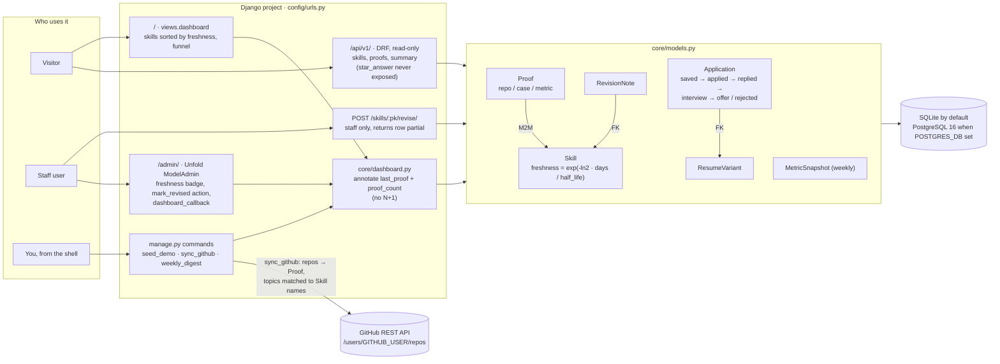

# Proof Ledger

A Django admin dashboard that tracks your skills, the proof behind each one, and your job-search
funnel. Skills lose freshness over time (a configurable half-life), so the dashboard always shows
what to revise next.

## Architecture



## Run it

```bash
python -m venv .venv && source .venv/bin/activate
pip install -r requirements-dev.txt
python manage.py migrate
python manage.py seed_demo
python manage.py createsuperuser
python manage.py runserver
```

- Public dashboard: http://localhost:8000/
- Admin: http://localhost:8000/admin/
- API: http://localhost:8000/api/v1/ (read-only)

Or with Postgres: `docker compose up`.

## Commands

| Command | What it does |
|---|---|
| `seed_demo` | Creates starter skills and resume variants. Edit levels to be honest. |
| `sync_github` | Pulls public repos as Proof rows, links skills by repo topic. Set `GITHUB_USER`, optional `GITHUB_TOKEN`. |
| `weekly_digest` | Prints a markdown plan: stale skills, unproven skills, funnel. |

## Quality

```bash
ruff check .
pytest --cov=core --cov-fail-under=85
```

## Design notes

- Freshness is `exp(-ln2 * days / half_life)`, tested with frozen time.
- Admin querysets annotate the last proof date, so the list view has no N+1 queries (tested).
- The API never exposes `star_answer`, your private interview drafts (tested).
- Marking a skill revised from the public page needs a logged-in staff user.

## Deploy (free)

A **Render free Python web service** and a **Neon free Postgres** project (Render's free Postgres is
deleted after 30 days; Neon's does not expire). `render.yaml` is the blueprint: `build.sh` installs and
collects static files (served by WhiteNoise), `start.sh` migrates, seeds, creates the admin user once
from `DJANGO_SUPERUSER_*`, then runs gunicorn.

In Render: New, Blueprint, pick this repo, then set `DATABASE_URL` (Neon connection string) and the
`DJANGO_SUPERUSER_*` values. `SECRET_KEY` is generated, and Render's hostname is added to `ALLOWED_HOSTS`.

- Free instances sleep after about 15 minutes idle.
- The Docker image was built and run locally with `DEBUG=0` against Postgres 16: dashboard, API, admin
  login and static files all returned 200.

## Roadmap

- [ ] Link-check command for proof URLs
- [ ] Topic-to-skill mapping table instead of name matching
- [ ] LLM-drafted STAR answers through a provider gateway
- [ ] React rebuild of the dashboard (`proof-ledger-ui`)

See `NOTES.md` for mistakes made and fixed.
